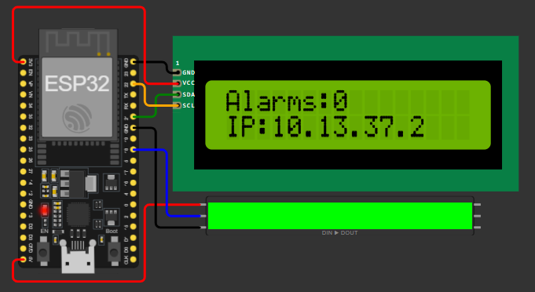
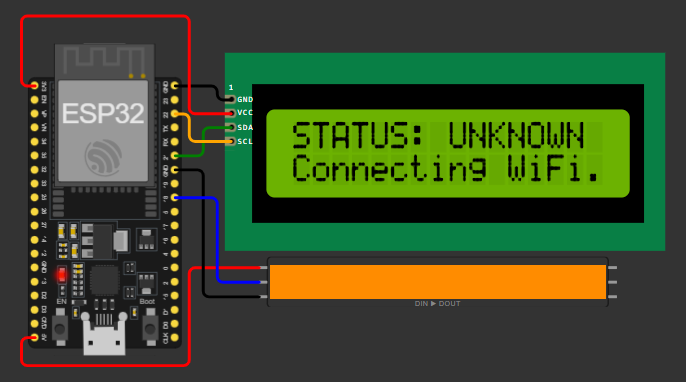
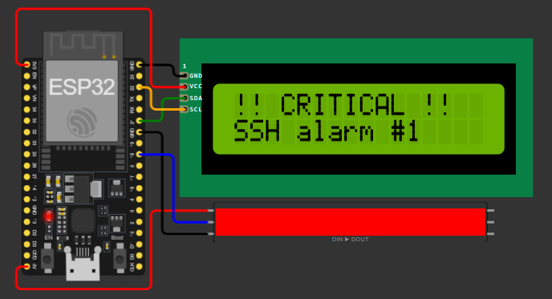
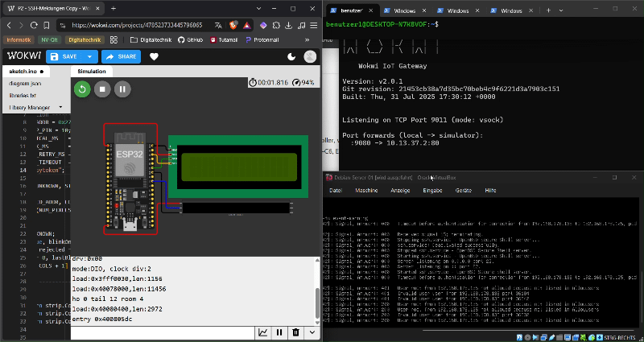

[Deutsch](README.md) | [English](EN-README.md)

# Log-based SSH Monitoring with IoT Status Display | 2026

A hardened SSH server (key authentication, 2FA, IP allowlisting, fail2ban) whose log is monitored in real time. Every log activity triggers an HTTP alert to an ESP32, which shows the alert count and its IP address on an LCD and visualizes the status with an LED strip.

## Introduction

A hardened, publicly reachable SSH port runs on a server (Debian VM). It is secured by key authentication, 2FA, IP allowlisting and fail2ban.

A Python script follows the SSH log in real time (`journalctl -fu ssh`). As soon as a new line appears, it sends a signal via HTTP POST (with a token in the header, at most one message per second) to an ESP32 on the local network.

The script does not analyze anything. It only detects that the log has changed, but not what happened or whether it was a real attack. The message is purely a notification that something has occurred.

The ESP32 (simulated in Wokwi here and connected to the network via the Private IoT Gateway) receives the message, checks the token and increments a counter. An LCD 1602 (I2C) shows the alert count and IP address, and an LED strip shows the current status.

### 🟢 Green: stable

Normal state. The display shows the alert count and IP address.



### 🟠 Orange: unknown

The ESP32 is starting up or has no WiFi connection.



### 🔴 Red (blinking): critical

An alert was received or a wrong token was sent. After a short time (`CRITICAL_MS`, default 2 seconds) the display automatically returns to green.



## Project Goal

A server and an ESP32 should communicate reliably with each other on the local network. The alerts are sent via HTTP request and secured by a token in the header. The transmission itself is unencrypted and intended for the local network only.

**Remote access:** For SSH access to the server while away from home, a VPN such as Tailscale is recommended instead of a public port forward on the router. It connects only authorized devices over a private, encrypted network without exposing the SSH port to the entire internet. The ESP32 is not affected by this and stays on the local network.

## Flow

```
SSH log ──► Python script (VM) ──► HTTP POST + token ──► ESP32 ──► LCD + LED strip
journalctl     event-warning.py       /alert               Counter    Status
```

In the simulation, the path runs through your PC: `VM → PC:9080 → Private IoT Gateway → ESP32 (Wokwi)`.

## Features

- Real-time monitoring of the SSH log (`journalctl`)
- Alert via HTTP POST to an ESP32, secured by a token in the header
- Rate limit of 1 second to prevent message flooding
- Display of alert count and IP address on an LCD 1602 (I2C)
- Status display via LED strip: green (stable), orange (unknown), red (critical)
- Automatic WiFi reconnect of the ESP32
- Hardened SSH access: keys, 2FA, UFW, fail2ban

## Hardware

| Component | Connection to ESP32 |
|-----------|---------------------|
| ESP32 | – |
| LCD 1602 with I2C module | SDA = GPIO 21, SCL = GPIO 22, VCC = 5 V, GND |
| WS2812/NeoPixel strip (10 LEDs) | Data = GPIO 18, 5 V, GND |

All components need a common GND.

## Setup

### 1. Your device: create a key

```bash
ssh-keygen -t ed25519
```

Copy the public key to the server.

Windows (PowerShell):

```powershell
type $env:USERPROFILE\.ssh\id_ed25519.pub | ssh USER@VM-IP "mkdir -p ~/.ssh && chmod 700 ~/.ssh && cat >> ~/.ssh/authorized_keys && chmod 600 ~/.ssh/authorized_keys"
```

Linux/macOS:

```bash
ssh-copy-id USER@VM-IP
```

Test the key login before you disable password authentication.

### 2. Server: basics

> **Important:** For all of the following changes, keep a second SSH session open and test changes in a new terminal. The VM window (hypervisor console, e.g. VirtualBox) serves as your emergency exit.

```bash
sudo apt update && sudo apt upgrade -y
sudo apt install openssh-server ufw -y
```

Set up the firewall:

```bash
sudo ufw default deny incoming
sudo ufw default allow outgoing
sudo ufw logging medium
sudo ufw allow 22/tcp
sudo ufw enable
```

### 3. Server: harden SSH

```bash
sudo nano /etc/ssh/sshd_config.d/00-hardening.conf
```

Content: see the file `config/00-hardening.conf` in the repository. Change `AllowUsers` there to a user on your server who is allowed to connect via SSH.

Then open the main configuration:

```bash
sudo nano /etc/ssh/sshd_config
```

Write this on the first line:

```
Include /etc/ssh/sshd_config.d/00-hardening.conf
```

SSH uses the first value it finds, so the line must be at the very top. Then verify (no output means everything is fine):

```bash
sudo sshd -t
```

### 4. Server: 2FA

```bash
sudo apt install libpam-google-authenticator -y
```

Run the following command as the user you entered under `AllowUsers` (not with `sudo`):

```bash
google-authenticator
```

You will be asked the following questions in order:

- **Do you want authentication tokens to be time-based (TOTP)?** Answer yes.
- **QR code:** A QR code appears. Scan it with any authenticator app and enter the code from the app in the terminal. On success you receive your emergency codes, each of which can only be used once. Store them securely outside the VM.
- **Update the configuration file (`~/.google_authenticator`)?** Answer yes so that the TOTP secret and the settings are saved.
- **Disallow multiple uses of the same token?** Answer yes. This makes replay and man-in-the-middle attacks harder. Answer the follow-up confirmation with yes as well.
- **Increase the time window (if asked)?** Answer no. A small time window is more secure. Only answer yes if the clock is significantly off.
- **Enable rate limiting?** Answer yes. Attackers then get at most 3 login attempts every 30 seconds.

This sets up 2FA for your user, but SSH only uses it once it is connected to PAM:

```bash
sudo nano /etc/pam.d/sshd
```

Comment out the line `@include common-auth` with `#`, otherwise SSH will additionally ask for the Linux password.

Insert this line at the very top:

```
auth required pam_google_authenticator.so
```

Verify and restart:

```bash
sudo sshd -t && sudo systemctl restart ssh
```

Test in a new terminal: first the key (and passphrase), then `Verification code:`.

### 5. Server: fail2ban

```bash
sudo apt install fail2ban -y
sudo nano /etc/fail2ban/jail.local
```

Content: see the file `config/jail.local` in the repository. Under `ignoreip`, enter the IPs of your trusted devices, and adjust `port` to your SSH port if it is not 22.

```bash
sudo systemctl enable --now fail2ban
sudo fail2ban-client status sshd
```

The last command shows whether fail2ban has intervened and banned any IPs.

### 6. Server: monitoring script and service

```bash
sudo mkdir -p /opt/event-warning
sudo nano /opt/event-warning/event-warning.py
```

Content: see the file `server/event-warning.py` in the repository. Enter the target URL and your token there (see the Configuration section).

```bash
sudo apt install curl -y
sudo chmod 700 /opt/event-warning/event-warning.py
```

The script contains the token, which is why the file permissions are restricted.

Create the service:

```bash
sudo nano /etc/systemd/system/event-warning.service
```

Content: see the file `server/event-warning.service` in the repository.

```bash
sudo systemctl daemon-reload
sudo systemctl enable --now event-warning
sudo journalctl -fu event-warning
```

### 7. ESP32

In the Arduino IDE, install the libraries LiquidCrystal I2C and Adafruit NeoPixel. `WiFi` and `WebServer` are part of the ESP32 core.

Open the sketch `esp32/ssh-alarm/ssh-alarm.ino`, enter the SSID and password of your WiFi (2.4 GHz only) and set the same token as in the script on the server.

For the Wokwi simulation only, follow the comment at `WiFi.begin` in the sketch. In addition, the Private IoT Gateway must be running, which forwards requests from your PC into the simulation.

Upload the sketch and note the IP address from the display or the Serial Monitor.

## Configuration

| What | Where | Value |
|------|-------|-------|
| Target URL | `event-warning.py` | Simulation (Private IoT Gateway): `http://PC-IP:9080/alert` <br> Real ESP32: `http://ESP32-IP/alert` |
| Token | Script and ESP32 | must be identical in both |
| WiFi | ESP32 sketch | `WiFi.begin("SSID", "Password")` |
| Duration of red display | ESP32 sketch | `CRITICAL_MS` (in milliseconds) |
| Brightness | ESP32 sketch | `BRIGHTNESS` (0 to 255) |

The IP address for the simulation depends on your network. It is the address of the computer running the Private IoT Gateway, as seen from the VM.

With a real ESP32, the VM should run in bridged network mode and the ESP32's IP should be reserved in the router, otherwise it may change.

## Usage

1. Start the ESP32. It briefly shows orange (unknown) and switches to green with alert count and IP once the WiFi connection is established.
2. Start the service on the server:

   ```bash
   sudo systemctl start event-warning
   ```

3. Trigger a log event, e.g. with a login attempt using a wrong username (only on your own system!):

   ```bash
   ssh wronguser@VM-IP
   ```

4. The ESP32 briefly shows red (blinking) with the message, increments the counter and then returns to green.

You can see the events themselves in the SSH log:

```bash
sudo journalctl -fu ssh
```

You can see whether a signal was sent in the service log:

```bash
sudo journalctl -fu event-warning
```

## Demo



## Troubleshooting

**Remove a device or key:** On the server, open `~/.ssh/authorized_keys` and delete the line with the device's key.

**No alert on the ESP32:**

Test the connection directly on the server:

```bash
curl -X POST http://ESP-ADDRESS/alert -H "X-Token: YOUR_TOKEN" -d "TEST"
```

If the LED turns on, the problem lies with the script or the service; otherwise it lies with the network, gateway or token (response `401` = wrong token, `404` = wrong path).

Check whether new lines appear in the SSH log at all:

```bash
sudo journalctl -u ssh -n 20 --no-pager
```

Check the service:

```bash
systemctl status event-warning
```

**Service does not start or was blocked:**

```bash
sudo journalctl -u event-warning -n 30 --no-pager
sudo systemctl reset-failed event-warning
sudo systemctl restart event-warning
```

Common causes are typos in the script or a wrong path in `ExecStart`.

**2FA code is rejected:** The time on the server and on your phone must be correct:

```bash
timedatectl
```

**Banned by fail2ban yourself:** The ban only affects SSH. Log in directly in the VM window on the server and unban your IP; no SSH connection is needed there:

```bash
sudo fail2ban-client set sshd unbanip YOUR-IP
```

**Locked out** (e.g. due to an error in the SSH configuration): Log in directly in the VM window (hypervisor console) and fix the configuration under `/etc/ssh/sshd_config.d/`.

## Security Notes

- Communication with the ESP32 runs over HTTP and is unencrypted. The token only prevents unauthorized requests, not eavesdropping. Use it only on the local network.
- Do not upload real tokens, WiFi passwords or keys to GitHub. Use placeholders or an unversioned file (`secrets.h`).
- Only scan and test systems that you own.
- Changing the SSH port only helps against mass scans. The real security comes from keys and 2FA.

## License

MIT License

## AI Usage Note

I used AI (Claude by Anthropic) to help with this README and to clean up the code.
