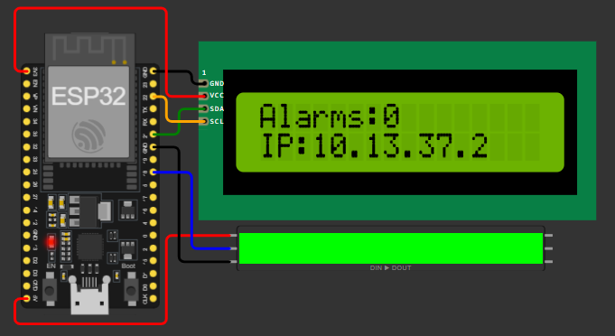
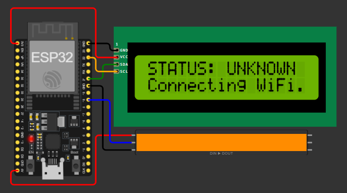
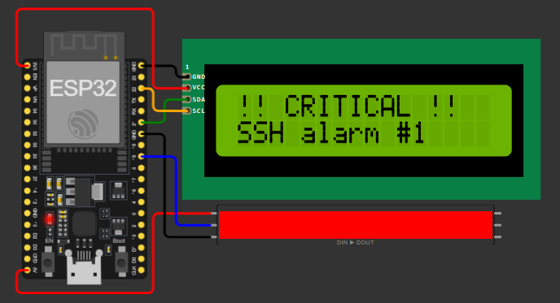
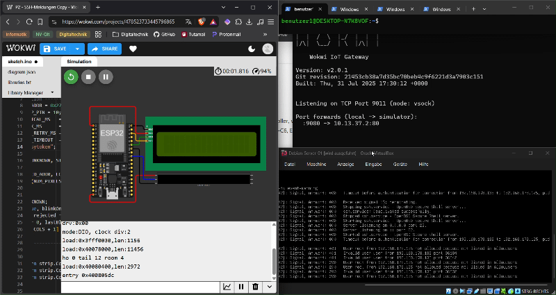

[Deutsch](README.md) | [English](EN-README.md)

# Log-basiertes SSH-Monitoring mit IoT-Statusanzeige | 2026

Gehärteter SSH-Server (Schlüssel, 2FA, IP-Freigabe, fail2ban), dessen Log in Echtzeit überwacht wird. Jede Log-Aktivität löst einen HTTP-Alarm an einen ESP32 aus, der Alarmanzahl und IP auf einem LCD anzeigt und den Status per LED-Streifen visualisiert.

## Einführung

Auf einem Server (Debian-VM) läuft ein gehärteter, offener SSH-Port. Abgesichert ist er durch Schlüssel-Authentifizierung, 2FA, IP-Freigabe und fail2ban.

Ein Python-Skript liest das SSH-Log in Echtzeit mit (`journalctl -fu ssh`). Sobald eine neue Zeile erscheint, sendet es per HTTP-POST (mit Token im Header, höchstens eine Meldung pro Sekunde) ein Signal an einen ESP32 im lokalen Netzwerk.

Das Skript wertet nichts aus. Es erkennt nur, dass sich das Log verändert hat, aber nicht, was passiert ist oder ob es ein echter Angriff war. Die Meldung ist ein reiner Hinweis, dass etwas geschehen ist.

Der ESP32 (hier in Wokwi simuliert und über das Private IoT Gateway mit dem Netzwerk verbunden) nimmt die Meldung an, prüft das Token und erhöht einen Zähler. Ein LCD 1602 (I2C) zeigt Alarmanzahl und IP-Adresse, ein LED-Streifen den aktuellen Status.

### 🟢 Grün: stabil

Normalzustand. Das Display zeigt Alarmanzahl und IP-Adresse.



### 🟠 Orange: unbekannt

Der ESP32 startet oder hat keine WLAN-Verbindung.



### 🔴 Rot (blinkend): kritisch

Ein Alarm wurde empfangen oder ein falsches Token wurde gesendet. Nach kurzer Zeit (`CRITICAL\_MS`, Standard 2 Sekunden) kehrt die Anzeige automatisch zu Grün zurück.



## Ziel des Projekts

Ein Server und ein ESP32 sollen im lokalen Netzwerk zuverlässig miteinander kommunizieren. Die Alarme werden per HTTP-Request übertragen und durch ein Token im Header abgesichert. Die Übertragung selbst ist unverschlüsselt und nur für das lokale Netzwerk gedacht.

**Zugriff von außen:** Für den SSH-Zugang zum Server von unterwegs empfiehlt sich statt einer öffentlichen Portweiterleitung im Router ein VPN wie Tailscale. Es verbindet nur berechtigte Geräte über ein privates, verschlüsseltes Netzwerk, ohne den SSH-Port für das gesamte Internet freizugeben. Der ESP32 ist davon nicht betroffen und bleibt im lokalen Netzwerk.

## Ablauf
```
SSH-Log ──► Python-Skript (VM) ──► HTTP-POST + Token ──► ESP32 ──► LCD + LED-Streifen
journalctl     event-warning.py       /alert                Zähler     Status
```
In der Simulation läuft der Weg über deinen PC: `VM → PC:9080 → Private IoT Gateway → ESP32 (Wokwi)`.
Features
Echtzeit-Überwachung des SSH-Logs (`journalctl`)
Alarm per HTTP-POST an einen ESP32, abgesichert durch ein Token im Header
Rate-Limit von 1 Sekunde gegen Meldungsflut
Anzeige von Alarmanzahl und IP auf einem LCD 1602 (I2C)
Statusanzeige per LED-Streifen: grün (stabil), orange (unbekannt), rot (kritisch)
Automatischer WLAN-Reconnect des ESP32
Gehärteter SSH-Zugang: Schlüssel, 2FA, UFW, fail2ban
Hardware
Bauteil	Anschluss am ESP32
ESP32	–
LCD 1602 mit I2C-Modul	SDA = GPIO 21, SCL = GPIO 22, VCC = 5 V, GND
WS2812/NeoPixel-Streifen (10 LEDs)	Daten = GPIO 18, 5 V, GND
Alle Bauteile brauchen ein gemeinsames GND.
Setup
1. Dein Gerät: Schlüssel erstellen
```bash
ssh-keygen -t ed25519
```
Öffentlichen Schlüssel auf den Server kopieren.
Windows (PowerShell):
```powershell
type $env:USERPROFILE\.ssh\id_ed25519.pub | ssh BENUTZER@VM-IP "mkdir -p ~/.ssh && chmod 700 ~/.ssh && cat >> ~/.ssh/authorized_keys && chmod 600 ~/.ssh/authorized_keys"
```
Linux/macOS:
```bash
ssh-copy-id BENUTZER@VM-IP
```
Teste den Login mit Schlüssel, bevor du das Passwort deaktivierst.
2. Server: Grundlagen
> **Wichtig:** Lass bei allen folgenden Änderungen eine zweite SSH-Sitzung offen und teste Änderungen in einem neuen Terminal. Als Notausgang dient das VM-Fenster (Konsole des Hypervisors, z. B. VirtualBox).
```bash
sudo apt update && sudo apt upgrade -y
sudo apt install openssh-server ufw -y
```
Firewall einrichten:
```bash
sudo ufw default deny incoming
sudo ufw default allow outgoing
sudo ufw logging medium
sudo ufw allow 22/tcp
sudo ufw enable
```
3. Server: SSH härten
```bash
sudo nano /etc/ssh/sshd_config.d/00-hardening.conf
```
Inhalt: siehe Datei `config/00-hardening.conf` im Repository. Passe dort `AllowUsers` an einen Benutzer deines Servers an, der sich per SSH verbinden darf.
Öffne anschließend die Hauptkonfiguration:
```bash
sudo nano /etc/ssh/sshd_config
```
Schreibe in die erste Zeile:
```
Include /etc/ssh/sshd_config.d/00-hardening.conf
```
Bei SSH gilt der erste Wert, deshalb muss die Zeile ganz oben stehen. Danach prüfen (keine Ausgabe bedeutet: alles in Ordnung):
```bash
sudo sshd -t
```
4. Server: 2FA
```bash
sudo apt install libpam-google-authenticator -y
```
Führe den folgenden Befehl als der Benutzer aus, den du bei `AllowUsers` eingetragen hast (nicht mit `sudo`):
```bash
google-authenticator
```
Du wirst nacheinander Folgendes gefragt:
Sollen die Tokens zeitbasiert (TOTP) sein? Mit Ja antworten.
QR-Code: Es erscheint ein QR-Code. Scanne ihn mit einer beliebigen Authenticator-App und gib den Code aus der App im Terminal ein. Bei Erfolg erhältst du deine Notfallcodes, die jeweils nur einmal verwendet werden können. Speichere sie sicher außerhalb der VM.
Soll die Konfigurationsdatei (`\~/.google\_authenticator`) aktualisiert werden? Mit Ja antworten, damit das TOTP-Geheimnis und die Einstellungen gespeichert werden.
Soll die mehrfache Verwendung desselben Tokens verboten werden? Mit Ja antworten. Das erschwert Replay- und Man-in-the-Middle-Angriffe. Die anschließende Bestätigung ebenfalls mit Ja beantworten.
Zeitfenster vergrößern (falls gefragt)? Mit Nein antworten. Ein kleines Zeitfenster ist sicherer. Nur bei stark abweichender Uhrzeit auf Ja stellen.
Rate-Limiting aktivieren? Mit Ja antworten. Angreifer haben dann höchstens 3 Anmeldeversuche alle 30 Sekunden.
Damit ist die 2FA für deinen Benutzer eingerichtet, SSH nutzt sie aber erst nach der Anbindung an PAM:
```bash
sudo nano /etc/pam.d/sshd
```
Kommentiere die Zeile `@include common-auth` mit `#` aus, sonst fragt SSH zusätzlich nach dem Linux-Passwort.
Füge ganz oben diese Zeile ein:
```
auth required pam_google_authenticator.so
```
Prüfen und neu starten:
```bash
sudo sshd -t && sudo systemctl restart ssh
```
Teste in einem neuen Terminal: erst Schlüssel (und Passphrase), dann `Verification code:`.
5. Server: fail2ban
```bash
sudo apt install fail2ban -y
sudo nano /etc/fail2ban/jail.local
```
Inhalt: siehe Datei `config/jail.local` im Repository. Trage bei `ignoreip` die IPs deiner vertrauten Geräte ein und passe bei `port` den SSH-Port an, falls er nicht 22 ist.
```bash
sudo systemctl enable --now fail2ban
sudo fail2ban-client status sshd
```
Der letzte Befehl zeigt dir, ob fail2ban eingegriffen und IPs gesperrt hat.
6. Server: Überwachungsskript und Dienst
```bash
sudo mkdir -p /opt/event-warning
sudo nano /opt/event-warning/event-warning.py
```
Inhalt: siehe Datei `server/event-warning.py` im Repository. Trage dort die Ziel-URL und dein Token ein (siehe Abschnitt Konfiguration).
```bash
sudo apt install curl -y
sudo chmod 700 /opt/event-warning/event-warning.py
```
Das Skript enthält das Token, deshalb sind die Dateirechte eingeschränkt.
Dienst anlegen:
```bash
sudo nano /etc/systemd/system/event-warning.service
```
Inhalt: siehe Datei `server/event-warning.service` im Repository.
```bash
sudo systemctl daemon-reload
sudo systemctl enable --now event-warning
sudo journalctl -fu event-warning
```
7. ESP32
Installiere in der Arduino IDE die Bibliotheken LiquidCrystal I2C und Adafruit NeoPixel. `WiFi` und `WebServer` gehören zum ESP32-Core.
Öffne die Skizze `esp32/ssh-alarm/ssh-alarm.ino`, trage SSID und Passwort deines WLANs ein (nur 2,4 GHz) und setze dasselbe Token wie im Skript auf dem Server.
Nur für die Simulation in Wokwi folgst du dem Kommentar bei `WiFi.begin` in der Skizze. Zusätzlich muss das Private IoT Gateway laufen, das Anfragen von deinem PC in die Simulation weiterleitet.
Lade die Skizze hoch und notiere die IP aus dem Display oder dem Serial Monitor.
Konfiguration
Was	Wo	Wert
Ziel-URL	`event-warning.py`	Simulation (Private IoT Gateway): `http://PC-IP:9080/alert` <br> Echter ESP32: `http://ESP32-IP/alert`
Token	Skript und ESP32	muss in beiden identisch sein
WLAN	ESP32-Skizze	`WiFi.begin("SSID", "Passwort")`
Dauer der roten Anzeige	ESP32-Skizze	`CRITICAL\_MS` (in Millisekunden)
Helligkeit	ESP32-Skizze	`BRIGHTNESS` (0 bis 255)
Die IP-Adresse für die Simulation hängt von deinem Netzwerk ab. Es ist die Adresse des Rechners, auf dem das Private IoT Gateway läuft, aus Sicht der VM.
Bei einem echten ESP32 sollte die VM in der Netzwerkbrücke laufen und die IP des ESP32 im Router reserviert sein, sonst kann sie sich ändern.
Verwendung
ESP32 starten. Er zeigt kurz Orange (unbekannt) und wechselt nach der WLAN-Verbindung auf Grün mit Alarmanzahl und IP.
Dienst auf dem Server starten:
```bash
   sudo systemctl start event-warning
   ```
Löse ein Log-Ereignis aus, z. B. mit einem Anmeldeversuch mit falschem Benutzernamen (nur an deinem eigenen System!):
```bash
   ssh falscherbenutzer@VM-IP
   ```
Der ESP32 zeigt kurz Rot (blinkend) mit der Meldung, erhöht den Zähler und kehrt danach zu Grün zurück.
Die Ereignisse selbst siehst du im SSH-Log:
```bash
sudo journalctl -fu ssh
```
Ob ein Signal gesendet wurde, siehst du im Dienst:
```bash
sudo journalctl -fu event-warning
```
Demo

Fehlerbehebung
Gerät oder Schlüssel entfernen: Öffne auf dem Server `\~/.ssh/authorized\_keys` und lösche die Zeile mit dem Schlüssel des Geräts.
Kein Alarm am ESP32:
Teste die Verbindung direkt auf dem Server:
```bash
   curl -X POST http://ESP-ADRESSE/alert -H "X-Token: DEIN_TOKEN" -d "TEST"
   ```
Geht die LED an, liegt es am Skript oder am Dienst, sonst an Netzwerk, Gateway oder Token (Antwort `401` = falsches Token, `404` = falscher Pfad).
Prüfe, ob im SSH-Log überhaupt neue Zeilen erscheinen:
```bash
   sudo journalctl -u ssh -n 20 --no-pager
   ```
Prüfe den Dienst:
```bash
   systemctl status event-warning
   ```
Dienst startet nicht oder wurde gesperrt:
```bash
sudo journalctl -u event-warning -n 30 --no-pager
sudo systemctl reset-failed event-warning
sudo systemctl restart event-warning
```
Häufige Ursachen sind Tippfehler im Skript oder ein falscher Pfad bei `ExecStart`.
2FA-Code wird abgelehnt: Die Uhrzeit von Server und Handy muss stimmen:
```bash
timedatectl
```
Selbst durch fail2ban gesperrt: Die Sperre betrifft nur SSH. Melde dich direkt im VM-Fenster am Server an und entsperre deine IP, dort brauchst du keine SSH-Verbindung:
```bash
sudo fail2ban-client set sshd unbanip DEINE-IP
```
Ausgesperrt (z. B. durch einen Fehler in der SSH-Konfiguration): Melde dich direkt im VM-Fenster (Konsole des Hypervisors) an und korrigiere die Konfiguration unter `/etc/ssh/sshd\_config.d/`.
Sicherheitshinweise
Die Kommunikation zum ESP32 läuft über HTTP und ist unverschlüsselt. Das Token verhindert nur unbefugte Anfragen, nicht das Mitlesen. Nutze es nur im lokalen Netzwerk.
Lade keine echten Tokens, WLAN-Passwörter oder Schlüssel auf GitHub hoch. Verwende Platzhalter oder eine nicht versionierte Datei (`secrets.h`).
Scanne und teste nur Systeme, die dir gehören.
Ein geänderter SSH-Port hilft nur gegen Massenscans. Die eigentliche Sicherheit kommt von Schlüssel und 2FA.
Lizenz
MIT License
Hinweis zur KI-Nutzung
Für diese README und für das Aufräumen des Codes habe ich KI (Claude von Anthropic) als Unterstützung verwendet.
